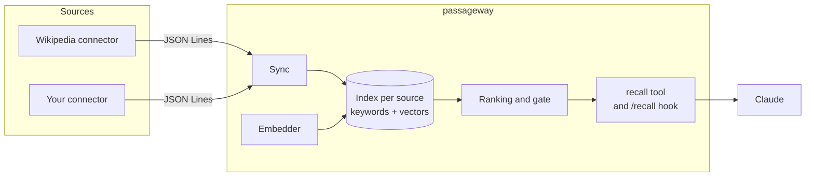
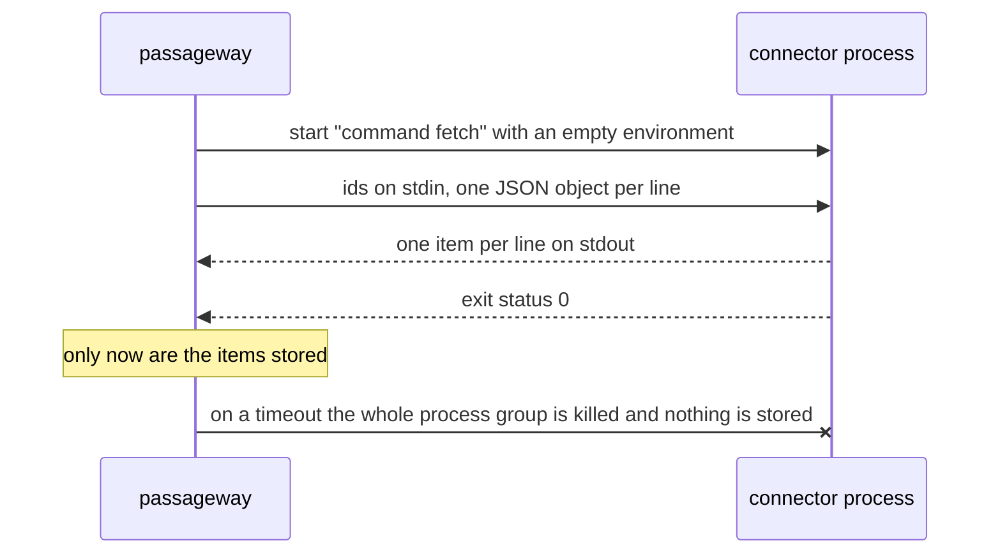
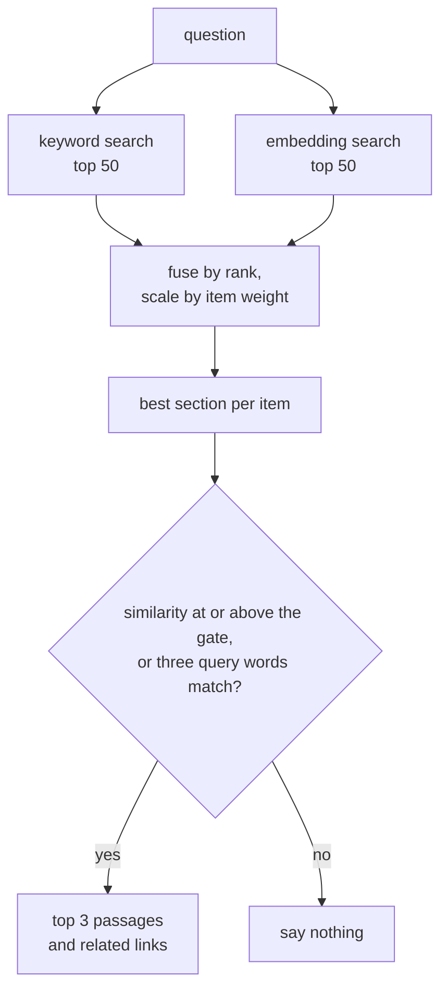

# How it works

## The pieces

Each connector is one **source** with its own SQLite file in the data directory. The sync loop asks the connector what exists and what changed, the embedder turns every section into a vector, and the index keeps both the text (for keyword search) and the vectors. The server answers questions from the indexes.

## A connector call

The core never imports a connector. It starts a process, reads its output, and stores something only if the call succeeded completely.

The environment contains only `PATH`, `HOME`, `PASSAGEWAY_PROTOCOL`, the connector's own `env` table and the secrets it names, so one connector never sees another's credentials or the server's password. A line over `max_line_bytes`, output over `max_output_bytes`, a malformed line, an id that was not requested, a non-zero exit and a timeout all fail the call. The [protocol reference](reference/connector-protocol.md) has the details.

## Keeping the index current

- **Start:** a source with no index yet (or one built with another embedder) is built in full; an existing index is reconciled instead.
- **Reconcile**, every 30 minutes (`PASSAGEWAY_RECONCILE_SECONDS`): the connector's `list` returns every item with its version. Items with a new version are fetched and re-embedded, items that disappeared are deleted.
- **Poll**, every minute (`PASSAGEWAY_POLL_SECONDS`): the connector's `changed --since` returns recent changes, so edits show up quickly. A connector that cannot answer this cheaply prints nothing and its edits wait for the next reconcile.
- **Deletion guard:** a reconcile that would remove more than `max_delete_fraction` of a source (30 % by default), or empty a source of two or more items, is refused and reported in `/health`. A broken listing therefore cannot wipe an index.

A source that fails keeps serving what it has; the other sources are not affected.

## Answering a question

1. **Candidates.** Keyword search (SQLite FTS5, BM25) and embedding search (cosine similarity on the vectors) each return their 50 best sections.
2. **Fusion.** The two rankings are combined by reciprocal rank, together with the cosine similarity. The score is multiplied by the item's `weight`, which a connector can use to rank one kind of content above another. The hook adds a small boost when a word from the last two folder names of the client's working directory appears in an item's title, path or labels.
3. **One hit per item.** Only the best section of each item competes.
4. **The gate.** A hit must reach `min_similarity` (the cosine threshold of the embedding model) or match at least three distinct query words. Anything below returns nothing at all. Similarity scales differ between embedding models, so the threshold belongs to the model.
5. **The answer.** Up to three passages with title, path, link and a short excerpt, plus up to three related items, trimmed to a budget of roughly 400 tokens.

## The hook endpoint

Besides the MCP tool, the server has `POST /recall` for a Claude Code prompt hook. It takes `{"prompt", "session_id", "cwd"}` and returns the context to inject. It skips prompts that are not questions (slash commands, "ok", "weiter", short follow-ups without a content word) and remembers per session which items it already sent. It accepts only the static bearer password. The Claude Code plugin that installs the hook is not shipped yet.

## Authentication

- **Bearer password (always):** `Authorization: Bearer <PASSAGEWAY_LOGIN_PASSWORD>` works for every API route except `/health`. (With OAuth on, the OAuth discovery, registration, authorize and token routes are open by design, as the protocol requires.)
- **OAuth login (optional):** set `PASSAGEWAY_BASE_URL` to the public https address and `/mcp` also accepts tokens from a login page protected by the same password. This is what remote MCP clients such as claude.ai need. The hook endpoint stays on the static password.
- **`/health`** is open, but shows connector error text only to a caller with the bearer password.
