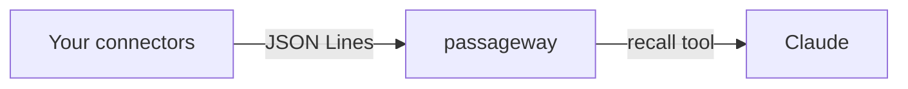

---
hide:
  - navigation
  - toc
---

<div class="pw-hero" markdown>

# Claude finds the right passage in your sources

<p class="pw-hero__lead">passageway indexes what your connectors report and gives Claude the best few passages for a question, with links. When nothing is relevant enough, it says nothing.</p>

[Install and run](install.md){ .md-button .md-button--primary }
[Write a connector](guides/write-a-connector.md){ .md-button }

</div>

## What it is

passageway is the retrieval half of a RAG system, served as an MCP tool. It does no generation: the model that calls it reads the passages and writes the answer.

- **The core knows no source.** A connector is any executable that lists items and prints their text as JSON Lines. Anyone can write one, in any language.
- **It is quiet on purpose.** A relevance gate lets it return nothing instead of padding a prompt with weak matches.
- **It runs small.** Keyword and embedding search in one SQLite file per source, on the CPU, with no vector database to run.

```toml
[[connector]]
name = "deep-learning"
command = ["/path/to/python", "-m", "passageway_connector_wikipedia"]
env = { LANGUAGE = "de", CATEGORIES = "Kategorie:Deep Learning" }
```



Before anything else, [what passageway stands for](values.md): the lines it does not cross and what you can rely on.

## Available today

- The [connector protocol](reference/connector-protocol.md) and a [guide to writing a connector](guides/write-a-connector.md)
- The [Wikipedia connector](connectors/wikipedia.md), in English and German
- The [Markdown connector](connectors/markdown.md), for a folder of markdown files with front matter
- Hybrid search with a relevance gate, described in [How it works](how-it-works.md)
- An [evaluation harness](guides/evaluate.md), `passageway eval`, that measures retrieval quality on your own questions, compares embedding models and builds a report you can publish
- Any embedding model through the [embedder protocol](reference/embedder-protocol.md): a program that turns texts into vectors

## Coming

These are planned and **not available yet** (the [roadmap](roadmap.md) has the order and the open decisions): presets and an automatic download for the built-in model family, an embedder for OpenAI-compatible services, a container image, a Claude Code plugin for the prompt hook, and connectors for Trilium and Confluence.
