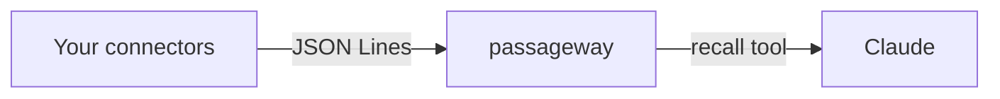

---
hide:
  - navigation
  - toc
---

<div class="pw-hero" markdown>

# The answer is somewhere in your wiki. passageway finds it.

<p class="pw-hero__lead">passageway searches across your wiki, notes and documentation and gives your agent exactly the passages that answer the question, each linked to its source.</p>

**On premise.** Your knowledge stays on your infrastructure.<br>
**Connected.** Confluence, Trilium, Markdown and Wikipedia work out of the box.<br>
**Open.** A documented protocol lets you add any source or embedding model, in any language.

Free for private use. Companies need a licence. [Details](licence.md)

[Install and run](install.md){ .md-button .md-button--primary }
[Write a connector](guides/write-a-connector.md){ .md-button }

</div>

## How it fits together

passageway is the retrieval half of a RAG system, served as an MCP tool. It does no generation: the agent that calls it reads the passages and writes the answer.

- **The core knows no source.** A connector is any executable that lists items and prints their text as JSON Lines. Anyone can write one, in any language.
- **It is quiet on purpose.** A relevance gate lets it return nothing instead of padding a prompt with weak matches.
- **It runs small.** Keyword and embedding search in one SQLite file per source, on the CPU, with no vector database to run.

```toml
[[connector]]
name = "deep-learning"
command = ["/path/to/python", "-m", "passageway_connector_wikipedia"]
env = { LANGUAGE = "de", CATEGORIES = "Kategorie:Deep Learning" }
```



Before anything else, [what passageway stands for](values.md): the lines it does not cross and what you can rely on.

## Available today

- The [connector protocol](reference/connector-protocol.md) and a [guide to writing a connector](guides/write-a-connector.md)
- The [Wikipedia connector](connectors/wikipedia.md), in English and German
- The [Markdown connector](connectors/markdown.md), for a folder of markdown files with front matter
- The [Sitemap connector](connectors/sitemap.md), a website from its sitemap and the pages its pages link to
- The [Trilium connector](connectors/trilium.md), the notes of a Trilium server with the LLM-wiki structure of trilium-recall
- The [Confluence connector](connectors/confluence.md), the pages of chosen spaces of a Confluence Data Center
- Hybrid search with a relevance gate, described in [How it works](how-it-works.md)
- A [Claude Code plugin](guides/claude-code.md) with the prompt hook and skills that install, connect, add sources, check and evaluate, a [container image](deploy.md) with the model baked in, and `passageway init` for a local service
- An [evaluation harness](guides/evaluate.md), `passageway eval`, that measures retrieval quality on your own questions, compares embedding models and builds a report you can publish
- Three built-in models (`passageway model list`), fetched pinned and checksummed; any other through the [embedder protocol](reference/embedder-protocol.md) or the bundled [OpenAI-compatible embedder](embedders/openai.md)

## Coming

Every step on the [roadmap](roadmap.md) has shipped, the last one trilium-recall pointing here; what is parked is listed there. [Choosing a model](models.md) compares the built-in models on the sample corpus.
